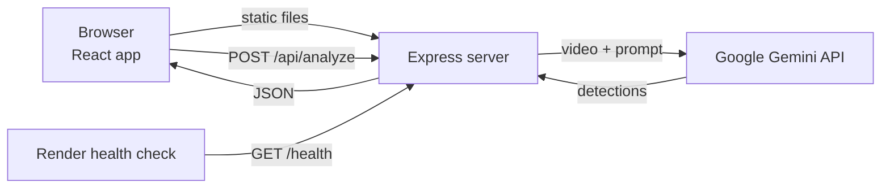

# 🕳️ Pothole Detection Dashboard

> AI-powered dashboard that detects potholes in road videos and visualizes pothole telemetry from CSV logs.


### 🔗 **[Live demo → pothole-detection-pgsq.onrender.com](https://pothole-detection-pgsq.onrender.com)**

> Hosted on Render's free plan. If the app has been idle, the first load can take about 50 seconds to wake up.

<!-- Add a screenshot or GIF of the dashboard here:
 -->

## Table of Contents

- [About](#about)
- [Features](#features)
- [Tech Stack](#tech-stack)
- [Architecture](#architecture)
- [Getting Started](#getting-started)
- [Environment Variables](#environment-variables)
- [CSV Format](#csv-format)
- [API Reference](#api-reference)
- [Deployment](#deployment)
- [Security](#security)
- [Troubleshooting](#troubleshooting)
- [Known Limitations](#known-limitations)
- [Roadmap](#roadmap)
- [Project Structure](#project-structure)
- [Author](#author)
- [License](#license)

## About

Potholes damage vehicles, cause accidents, and are costly to repair, but many roads are still inspected by hand, which is slow and inconsistent. This project is a web dashboard that makes road-condition analysis faster and easier to understand.

Users can upload dashcam or road-survey footage, and a multimodal AI model (Google Gemini) identifies potholes in the video and describes what it finds. Users can also upload CSV logs from detection hardware or earlier surveys to view pothole counts, severity levels, confidence scores, and locations as interactive charts.

The frontend is React and TypeScript, and an Express backend keeps the API key off the browser. The app is containerized with Docker and deployed on Render.

**Who it's for:** students, researchers, and municipal teams exploring low-cost, AI-assisted road inspection.

## Features

- 🎥 **Video analysis:** upload a road video (MP4, MOV, AVI) or paste a direct video URL, and Gemini identifies and describes potholes in the footage.
- 📊 **CSV telemetry:** upload pothole logs (latitude, longitude, altitude, pothole counts, severity, confidence, processing time) and explore them in interactive charts.
- 🔐 **Secure backend proxy:** the Gemini API key stays on the server and is never exposed to the browser.
- 🛡️ **Abuse protection:** per-IP rate limiting and a global daily cap on analysis requests.
- 🐳 **Containerized:** multi-stage Docker build, runs as a non-root user, with a `/health` endpoint.

## Tech Stack

| Layer | Technology |
|---|---|
| Frontend | React 19, TypeScript, Vite, Tailwind CSS, Recharts, PapaParse |
| Backend | Node.js 20, Express |
| AI | Google Gemini via `@google/genai` (default model `gemini-2.5-flash`) |
| Deployment | Docker, Render (Blueprint via `render.yaml`) |

## Architecture

One service serves both the UI and the API.



The API key lives only in the server's environment. The browser never sees it.

## Getting Started

### Prerequisites

- Node.js 20+
- A Gemini API key from [Google AI Studio](https://aistudio.google.com/apikey)
- Docker (optional, for container runs)

### Run locally

```bash
git clone https://github.com/vanshiiii11/pothole-detection.git
cd pothole-detection
npm install
cp .env.example .env     # then add your GEMINI_API_KEY
npm run build            # builds client into dist/ and server into dist-server/
npm start                # full-stack server on http://localhost:8080
```

For frontend-only development with Vite hot reloading:

```bash
npm run dev
```

> Video analysis needs the Express server, so use `npm run build && npm start` to test it end to end.

### Run with Docker

```bash
docker build -t pothole-detection .
docker run --rm -p 8080:8080 --env-file .env pothole-detection
```

Then open http://localhost:8080.

## Environment Variables

| Variable | Required | Default | Description |
|---|---|---|---|
| `GEMINI_API_KEY` | Yes | none | Your Google AI Studio key |
| `GEMINI_MODEL` | No | `gemini-2.5-flash` | Gemini model used for analysis |
| `PORT` | No | `8080` | Server port (Render sets this automatically) |
| `RATE_LIMIT_PER_MINUTE` | No | `5` | Max analyses per IP per minute |
| `GLOBAL_DAILY_CAP` | No | `200` | Max analyses per day across all users |

Never commit your `.env` file. It is gitignored.

## CSV Format

The dashboard accepts CSV files with flexible column headers (exact, fuzzy, or aliases). A typical log file includes:

```csv
latitude,longitude,altitude,pothole_count,severity,average_confidence,frames_with_detection,time_processing,timestamp
23.1815,79.9864,411.2,3,3,0.91,14,24,2026-10-11T12:00:00Z
```

Supported aliases include `lat`/`latitude`, `long`/`lon`/`longitude`, `alt`/`altitude`, `pothole_count`/`count`, `severity` (numeric 1–5), `average_confidence`/`confidence`, `frames_with_detection`/`frames`, and `time_processing`/`processing_time`.

## API Reference

### `GET /health`

Returns `200` when the server is up.

```json
{ "status": "ok", "uptime": 204.1, "timestamp": "2026-10-11T19:06:08.982Z", "geminiConfigured": true }
```

### `POST /api/analyze`

Receives a video, calls Gemini, and returns the detections.

| Status | Meaning |
|---|---|
| `200` | Analysis succeeded |
| `400` | Missing required payload (`base64Data`) |
| `413` | Payload too large (body limit is 35 MB base64, ~20 MB raw video) |
| `429` | Rate limit or daily cap exceeded (see the `Retry-After` header) |
| `500` | Server or Gemini API error |
| `502` | Empty response from Gemini AI model |

## Deployment

Deployed on [Render](https://render.com) with Docker. The Docker image builds the app itself, so no pre-built folders are needed in the repo.

1. Push the repo to GitHub.
2. On Render, choose **New → Blueprint** and select this repo. Render reads `render.yaml`.
3. Enter `GEMINI_API_KEY` in the dashboard when prompted.
4. Render builds the image and deploys. Later pushes to `main` redeploy automatically.

Changing `GEMINI_MODEL` in Render's **Environment** tab restarts the service without a rebuild.

## Security

- The Gemini key is read from server-side environment variables only. It is not in the client bundle, the Docker image, or the repo.
- `.env` is excluded by both `.gitignore` and `.dockerignore`.
- The container runs as a non-root user.
- Per-IP rate limiting and a global daily cap protect the public endpoint and your API quota.
- Recommended: also set a quota or spending limit on your key in Google AI Studio or Google Cloud.

## Troubleshooting

| Problem | Likely cause and fix |
|---|---|
| First page load takes ~50 s | Render's free instance was asleep. Wait and refresh. |
| `geminiConfigured: false` on `/health` | `GEMINI_API_KEY` is missing. Add it in Render's **Environment** tab. |
| Video analysis returns a model error | Set `GEMINI_MODEL=gemini-2.5-flash`. |
| `429 Too Many Requests` | You hit the rate limit or Gemini's free-tier quota. Wait and retry. |
| `413` or upload fails | The video is too large. Try a shorter or smaller clip. |
| Video URL won't load | The remote host must allow CORS. Upload the file instead. |

## Known Limitations

- **Video size:** uploads are capped at 20 MB. Gemini's inline request limit is close to this once the video is base64-encoded, so smaller clips (under about 10 MB) are the most reliable.
- **Video URLs:** the remote host must allow CORS.
- **Cold starts:** the free Render instance sleeps when idle, so the first request is slow.
- **Rate limits:** limits are in memory and reset when the server restarts. Gemini's free-tier quota also applies.
- **Detection method:** results come from a multimodal LLM, not a custom-trained detection model, so accuracy varies with video quality.

## Roadmap

- [ ] Gemini Files API support for larger videos
- [ ] Map view of pothole locations from CSV data
- [ ] Export analysis results as CSV or PDF
- [ ] Custom-trained detection model (YOLO) for frame-level bounding boxes
- [ ] Persistent storage and user history

## Project Structure

```
├── src/              React frontend (components, pages)
├── server/           Express backend (/health, /api/analyze)
├── Dockerfile        Multi-stage production build
├── render.yaml       Render Blueprint
├── .env.example      Environment variable template
└── README.md
```

## Author

**Vanshika Motwani**  
GitHub: [@vanshiiii11](https://github.com/vanshiiii11)

## License

MIT
